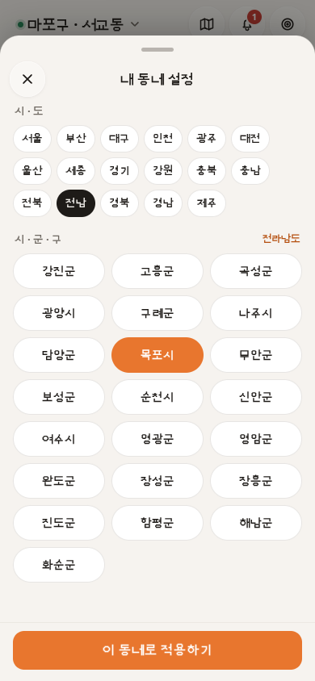
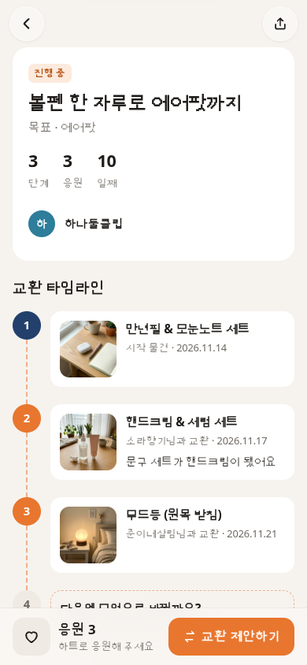
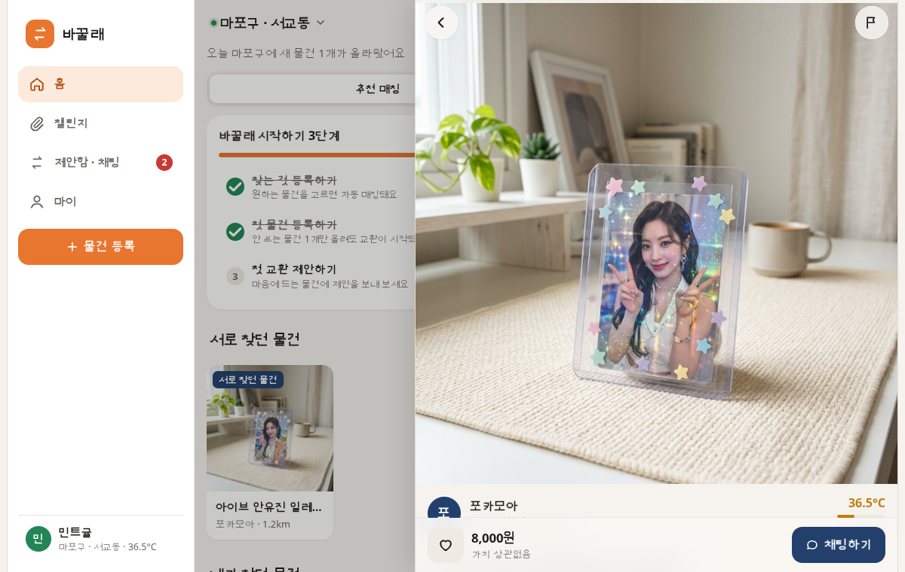
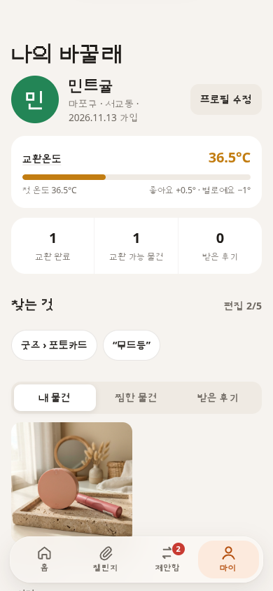

# 바꿀래

**돈 쓰지 않고, 내가 가진 것으로 필요한 물건을 바꾸는 우리 동네 물물교환 웹앱.**

---

## 앱 소개

**바꿀래**는 안 쓰는 물건과 내가 찾고 있는 물건(`카테고리 · 키워드`)을 등록하면, 서로 원하는 물건을 가진 동네 이웃을 자동으로 연결해 주는 P2P 물물교환 서비스입니다.  
지역 기반 탐색부터 교환 제안, 1:1 실시간 채팅, 그리고 작은 물건 하나를 이어 더 큰 목표에 도전하는 **빨간 클립 챌린지**까지 하나의 흐름으로 경험할 수 있습니다.

## 제작 계기

서랍이나 방 한쪽에 방치된 멀쩡한 물건들이 가격 흥정이나 현금 거래의 부담 없이 **꼭 필요로 하는 이웃의 손**으로 이어졌으면 하는 생각에서 출발했습니다.  
단순히 물건을 처분하는 중고 거래를 넘어, “내가 가진 작은 물건 하나로 어디까지 바꿔볼 수 있을까?”라는 **빨간 클립 일화**의 설렘과 이웃 간의 신뢰(`교환온도`)가 쌓이는 따뜻한 교환 경험을 담고자 만들었습니다.

---

## 주요 기능

### 1. 서로 찾던 물건 자동 매칭
가진 물건과 `찾는 것(카테고리 · 키워드)`을 등록하면, 내 물건을 원하는 이웃과 내가 찾던 물건을 **서로 찾던 물건 / 내가 찾던 물건**으로 바로 추천합니다.

---

### 2. 전국 시·도 / 시·군·구 동네 설정 & 주변 지도
현재 위치(GPS)와 카카오맵으로 내 동네를 인증하거나, 전국 17개 시·도 및 시·군·구를 직접 선택해 탐색 범위(`2km` · `5km` · `전체 지역`) 안의 물건을 지도 핀과 거리순으로 살펴볼 수 있습니다.

  
  

---

### 3. 교환 제안 · 1:1 실시간 채팅
원하는 물건에 내 물건과 교환 방식(`대면` · `문고리` · `택배`), 만남 장소를 골라 제안할 수 있습니다. 제안이 수락되면 1:1 채팅방이 열리며 실시간 대화, 사진 전송, 읽음 표시, 개인정보 입력 주의 안내를 지원합니다.

---

### 4. 빨간 클립 릴레이 챌린지
작은 물건 하나에서 시작해 목표 물건까지 이어가는 릴레이 교환 과정을 단계별 타임라인으로 기록하고, 이웃의 응원(하트)과 완주 공유 카드를 나눌 수 있습니다.

---

### 5. 모바일 · 태블릿 · 데스크톱 반응형 UI
모바일에서는 하단 탭바 중심의 한 손 조작 UI를, 태블릿·데스크톱 화면에서는 사이드 메뉴와 상세·채팅 화면을 오가며 빠르게 탐색할 수 있는 반응형 레이아웃을 제공합니다.

---

### 6. 교환온도 · 후기 & 마이페이지
교환을 마친 뒤 후기를 주고받으며 **교환온도(°C)**가 쌓이고, 내가 등록한 물건 · 찜한 물건 · 받은 후기 및 동네/계정 설정을 마이페이지에서 한눈에 관리할 수 있습니다.

