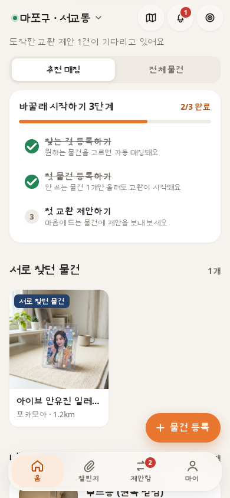
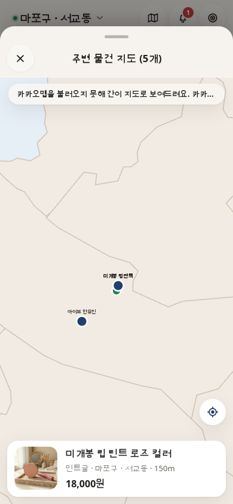
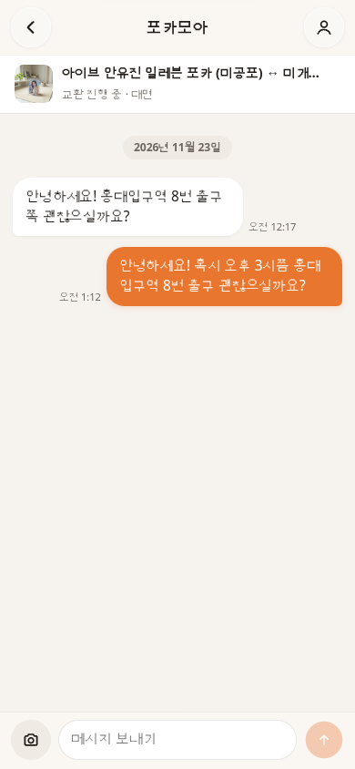

# 바꿀래

**돈 쓰지 않고, 내가 가진 것으로 필요한 물건을 바꾸는 우리 동네 물물교환 웹앱.**

서로 찾는 물건을 등록하면 잘 맞는 이웃과 자동으로 이어주고, 위치 기반 탐색과 1:1 채팅, 빨간 클립 릴레이 챌린지까지 한곳에서 즐길 수 있습니다.

---

## 주요 기능

### 1. 서로 찾던 물건 자동 매칭
가진 물건과 `찾는 것(카테고리 · 키워드)`을 등록하면, 내 물건을 원하는 이웃과 내가 찾던 물건을 **서로 찾던 물건 / 내가 찾던 물건**으로 바로 추천합니다.

---

### 2. 전국 시·도 / 시·군·구 동네 설정 & 주변 지도
현재 위치(GPS)와 카카오맵으로 내 동네를 인증하거나, 전국 17개 시·도 및 시·군·구를 직접 선택해 탐색 범위(`2km` · `5km` · `전체 지역`) 안의 물건을 지도와 거리순으로 살펴볼 수 있습니다.

  
  

---

### 3. 교환 제안 · 1:1 실시간 채팅
원하는 물건에 내 물건과 교환 방식(`대면` · `문고리` · `택배`), 만남 장소를 골라 제안할 수 있습니다. 제안이 수락되면 1:1 채팅방이 열리며 실시간 대화와 사진 전송, 읽음 표시를 지원합니다.

---

### 4. 빨간 클립 릴레이 챌린지
작은 물건 하나에서 시작해 더 큰 목표 물건까지 이어가는 릴레이 교환 과정을 타임라인으로 기록하고 이웃들의 응원을 받을 수 있습니다.

---

### 5. 교환온도 · 후기 & 마이페이지
교환을 마친 뒤 후기를 주고받으며 **교환온도**가 쌓이고, 내 물건 · 찜한 물건 · 받은 후기 및 동네/계정 설정을 한눈에 관리할 수 있습니다.

